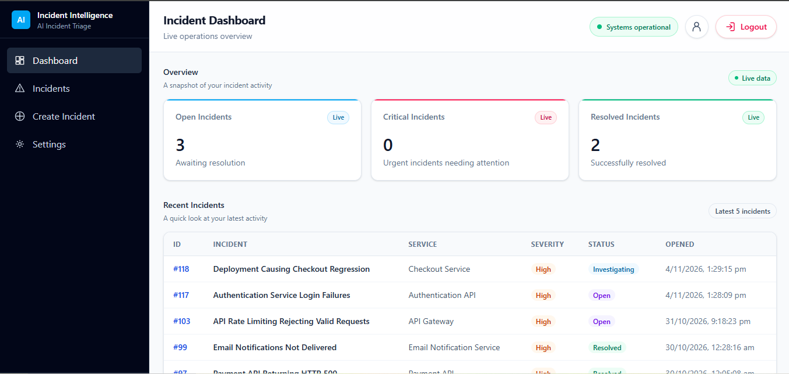

# AI Incident Intelligence & Root Cause Assistant

**Live Demo:** (https://ai-incident-intelligence-khaki.vercel.app/)

## Application Preview



An AI-powered incident investigation platform that helps users analyze technical incidents, retrieve relevant historical cases, investigate possible root causes, and generate actionable reports.

The application combines Retrieval-Augmented Generation (RAG), vector similarity search, LLM-based analysis, critic evaluation, and human review to support a structured incident investigation workflow.

## Key Features

- **Incident Management:** Create, view, and manage technical incidents.
- **AI-Powered Triage:** Generate incident summaries, classifications, severity assessments, and recommended actions.
- **Similar Incident Retrieval:** Find relevant historical incidents using 384-dimensional feature-hashed vectors and pgvector similarity search.
- **RAG-Based Investigation:** Use retrieved historical incidents as supporting context for root-cause analysis.
- **LLM Critic Review:** Evaluate proposed root causes against available evidence before finalisation.
- **Human-in-the-Loop Review:** Allow users to review and approve proposed root-cause analysis.
- **Investigation Tracking:** Track incident status updates and investigation activities.
- **Final Report Generation:** Generate reports based on the reviewed and approved investigation.

## Investigation Workflow

1. **Incident Creation:** The user submits a technical incident.
2. **AI Triage:** The system generates a structured incident analysis.
3. **Historical Retrieval:** Similar incidents are retrieved using feature-hashed vectors and pgvector similarity search.
4. **Root-Cause Analysis:** The LLM uses the retrieved context to propose possible causes and recommended actions.
5. **Critic Evaluation:** A separate LLM critic checks whether the proposed root cause is supported by the available evidence.
6. **Human Review:** The user reviews and approves the proposed analysis.
7. **Final Report:** The system generates the final incident investigation report.

## Tech Stack

| Layer | Technologies |
|---|---|
| Frontend | React, JavaScript, Tailwind CSS |
| Backend | Python, FastAPI, Pydantic |
| Database | Supabase PostgreSQL, SQLAlchemy |
| AI / LLM | Groq API |
| Retrieval | RAG, 384-dimensional feature hashing |
| Vector Search | pgvector |
| Deployment | Vercel, Render |

## Running Locally

### Prerequisites

- Python
- Node.js and npm
- PostgreSQL database with pgvector support
- Groq API key

### 1. Clone the repository

```bash
git clone https://github.com/siddigari-kerthii-sri/ai-incident-intelligence.git
cd ai-incident-intelligence
```

### 2. Set up the backend

```bash
cd backend
python -m venv venv
```

Activate the virtual environment:

**Windows**
```bash
venv\Scripts\activate
```

**macOS/Linux**
```bash
source venv/bin/activate
```

Install dependencies:

```bash
pip install -r requirements.txt
```

Configure the backend environment variables using the required values from your project configuration.

Start the backend:

```bash
uvicorn main:app --reload
```

### 3. Set up the frontend

Open a separate terminal from the project root:

```bash
cd frontend
npm install
```

Configure the frontend environment variables as required by the application.

Start the development server:

```bash
npm run dev
```

Open the local URL provided by Vite, usually `http://localhost:5173`.

## Deployment

- Frontend: Vercel
- Backend: Render
- Database: Supabase PostgreSQL

## Project Highlights

This project explores how LLM-powered incident investigation can be made more structured and evidence-aware by combining historical incident retrieval, independent critic evaluation, and human approval rather than relying on a single generated response.
